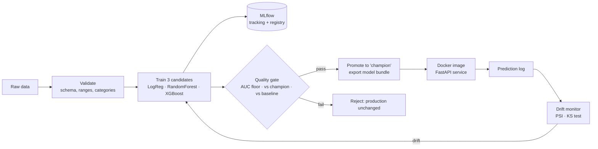
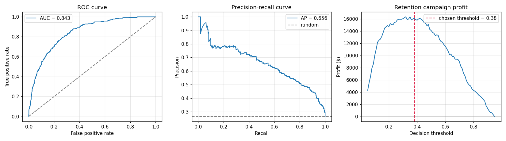
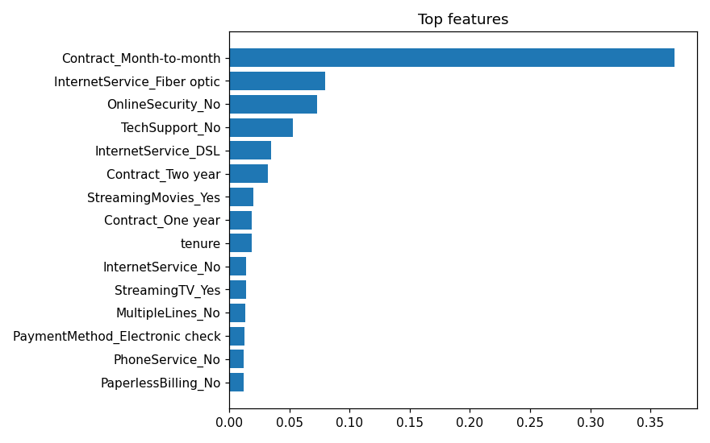
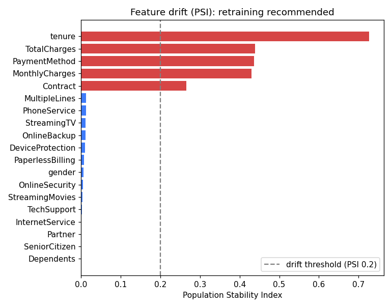

# 📉 Customer Churn Prediction: End-to-End MLOps Pipeline

[](https://github.com/KirollosMessak/churn-mlops/actions/workflows/ci.yml)
[](https://github.com/KirollosMessak/churn-mlops/actions/workflows/monitoring.yml)
   

A production-style machine learning system that predicts which customers are about to cancel, and only ships a new model when it's provably better. It covers the full lifecycle: **data validation → training → experiment tracking → model registry → quality gate → API → Docker → CI/CD → drift monitoring**.

> **Business result:** on 1,409 held-out customers, a retention campaign driven by this model earns **$16,100**, while contacting every customer **loses $14,350**. The decision threshold is tuned for **profit**, not just accuracy.

## Architecture



**CI/CD (GitHub Actions):** every push runs lint and tests, retrains, applies the quality gate, builds the Docker image, **smoke-tests the running container**, and publishes it to GitHub Container Registry. A scheduled workflow checks for drift every week.

## What this project demonstrates

| MLOps capability | Implementation |
|---|---|
| Reproducible pipeline | One YAML config, fixed seeds, pinned dependencies. Retraining gives identical scores. |
| Data validation | Schema, missing values, allowed categories and numeric ranges, with every problem reported at once (`data.py`) |
| Experiment tracking | Every candidate logged to **MLflow**: parameters, metrics, plots, model files |
| Model registry | Versioned models with a `champion` alias for the production model |
| Automated quality gate | A new model ships only if it meets a minimum AUC, **isn't worse than the current production model**, and beats the no-model baseline. Otherwise CI fails and nothing deploys. |
| Business-aware decisions | Threshold chosen to maximize retention-campaign profit (offer cost vs. customer value) |
| Model serving | **FastAPI** with typed input validation, batch scoring, health check, model info, service metrics and auto-generated docs |
| Containerization | Slim, non-root Docker image with a health check; `docker compose` adds an MLflow tracking server |
| CI/CD | Lint → test → train → gate → build → smoke test → publish |
| Monitoring | Every prediction is logged; drift detection (PSI + KS test) with an HTML report and a "retrain" signal |
| Testing | 16 unit and integration tests: data, metrics, API, drift |

## Results

Test set (1,409 customers never used for training or model selection):

| Metric | Value |
|---|---|
| ROC-AUC | **0.843** |
| PR-AUC | 0.656 (baseline: 0.265) |
| Precision / recall at the profit-optimal threshold (0.38) | 0.58 / 0.68 |
| Campaign profit: model | **+$16,100** |
| Campaign profit: contact everyone | −$14,350 |

XGBoost was selected over logistic regression and random forest on validation ROC-AUC. All three runs are recorded in MLflow for comparison.



**How the threshold is chosen.** Each retention offer costs $50; a contacted customer who would have churned stays 30% of the time, keeping $500 of value. The right panel shows profit for every threshold; the pipeline picks the peak **on validation data** and then reports it on the untouched test set. These assumptions live in `configs/config.yaml`, so a business can plug in its own numbers.



## Monitoring: catching a changing market

The API logs every request. The drift monitor compares recent inputs to the training data:
- **Numeric features:** Population Stability Index (PSI) and Kolmogorov–Smirnov test
- **Categorical features:** PSI on category frequencies
- **Predictions:** shift in average predicted churn

To demonstrate it, `simulate.py` sends traffic through the API in two scenarios:

| Scenario | What changes | Result |
|---|---|---|
| `normal` | Nothing (new customers like the training data) | 0 / 19 features drifted → **no action** |
| `drift` | 25% price increase on fiber plans; a promotion brings in many new month-to-month, electronic-check customers | 5 / 19 features drifted, predicted churn 26.6% → 41.3% → **retraining recommended** |



The full HTML report ([example](docs/drift_report_example.html), download and open in a browser) shows a verdict, summary cards, and per-feature charts and explanations such as *"Electronic check: 34% → 66%"*.

## Quick start

```bash
git clone https://github.com/KirollosMessak/churn-mlops.git
cd churn-mlops
pip install -r requirements.txt
export PYTHONPATH=src            # Windows PowerShell: $env:PYTHONPATH="src"

python -m churn.train                                    # validate → train → gate → promote
uvicorn churn.api:app --reload                           # API docs at http://localhost:8000/docs
python -m churn.monitoring.simulate --scenario drift     # send production-like traffic
python -m churn.monitoring.drift                         # reports/drift_report.html
mlflow ui --backend-store-uri sqlite:///mlflow.db        # experiments at http://localhost:5000
pytest                                                   # tests
```

The repo includes a trained model in `models/champion/`, so the API runs without training first. A `Makefile` wraps these commands (`make train`, `make serve`, …).

**Docker:**
```bash
docker compose up --build      # API on :8000, MLflow tracking server on :5000
```
Or pull the image that CI publishes: `docker pull ghcr.io/kirollosmessak/churn-mlops:latest`.

### Example request

```bash
curl -X POST localhost:8000/predict -H "Content-Type: application/json" -d '{
  "gender": "Female", "SeniorCitizen": "0", "Partner": "No", "Dependents": "No", "tenure": 2,
  "PhoneService": "Yes", "MultipleLines": "No", "InternetService": "Fiber optic",
  "OnlineSecurity": "No", "OnlineBackup": "No", "DeviceProtection": "No", "TechSupport": "No",
  "StreamingTV": "Yes", "StreamingMovies": "Yes", "Contract": "Month-to-month",
  "PaperlessBilling": "Yes", "PaymentMethod": "Electronic check",
  "MonthlyCharges": 95.5, "TotalCharges": 191.0}'
```
```json
{"churn_probability": 0.7637, "will_churn": true, "risk_level": "high",
 "recommended_action": "Contact now with a retention offer", "model_version": 3, "request_id": "186edb5f7fc2"}
```
Invalid input (e.g. `"tenure": -1` or `"Contract": "Weekly"`) returns a `422` that names each bad field.

| Endpoint | Purpose |
|---|---|
| `POST /predict` | Score one customer |
| `POST /predict/batch` | Score up to 1,000 customers, with the expected campaign profit |
| `GET /health` | Liveness/readiness for load balancers and Docker |
| `GET /model-info` | Version, type, threshold and test metrics of the serving model |
| `GET /metrics` | Uptime, predictions served, errors |

## Project structure

```
├── configs/config.yaml          # features, models, business costs, gate thresholds, monitoring
├── src/churn/
│   ├── data.py                  # load, clean, validate, split
│   ├── features.py              # preprocessing + model pipelines
│   ├── evaluation.py            # metrics, profit-optimal threshold, plots
│   ├── train.py                 # pipeline: train → MLflow → quality gate → promote
│   ├── api.py                   # FastAPI service
│   └── monitoring/
│       ├── simulate.py          # production traffic (normal / drifted)
│       └── drift.py             # PSI + KS drift detection, HTML report
├── models/champion/             # exported production model + metadata + reference data
├── tests/                       # 16 tests
├── Dockerfile · docker-compose.yml · Makefile
└── .github/workflows/
    ├── ci.yml                   # lint → test → train → gate → docker → publish
    └── monitoring.yml           # weekly drift check
```

## Design decisions

- **Three-way split.** Validation data picks the model and threshold; the test set is used once, for the final report and the gate. This avoids reporting optimistic numbers.
- **The gate compares against production**, not just a fixed floor, so a retrain on bad data can't silently replace a better model.
- **Serving doesn't depend on the MLflow server.** The champion is exported as a self-contained bundle, so the API has one less runtime dependency. MLflow stays the system of record.
- **`handle_unknown="ignore"`** in the encoder, together with strict API validation: unknown values are rejected at the API boundary, while the model itself never crashes on them.
- **`xgboost-cpu` in Linux builds** avoids a ~200 MB CUDA dependency the API doesn't need.

## Data

[IBM Telco Customer Churn](https://github.com/IBM/telco-customer-churn-on-icp4d) (7,043 customers, 21 columns), licensed Apache-2.0 and included in `data/raw/`.

## About me

I build production AI systems for businesses: ML pipelines and MLOps, LLM apps, and custom models, with a focus on **Arabic and English**.
More projects: [Chat with your PDFs](https://github.com/KirollosMessak/ai-pdf-chat) · [AI Support Ticket Extractor](https://github.com/KirollosMessak/ai-ticket-extractor) · [Arabic Handwriting CNN](https://github.com/KirollosMessak/arabic-handwriting-cnn)

## License

MIT (code). Dataset: Apache-2.0, © IBM.
